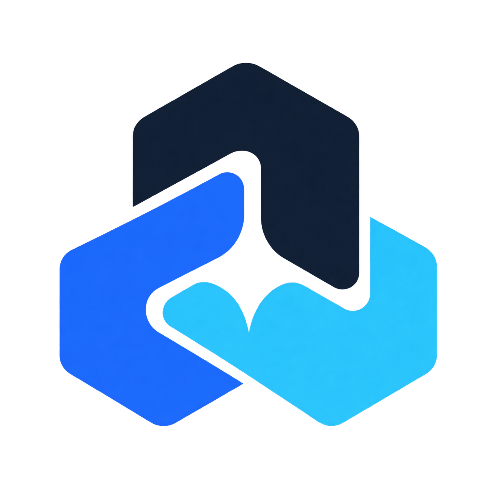

<p align="center">
  
</p>

<h1 align="center">Web Toolbox · 多功能工具箱</h1>

<p align="center">Everyday tools in your browser</p>

<p align="center">
  <a href="./README.md">简体中文</a> ·
  <a href="./README.zh-TW.md">繁體中文</a> ·
  <a href="./README.en.md"><strong>English</strong></a>
</p>

<p align="center">
  <a href="https://tool.easonzhan.xyz/"></a>
  <a href="https://github.com/EasonZe/web-toolbox/releases/latest"></a>
  <a href="https://github.com/EasonZe/web-toolbox/actions/workflows/ci.yml"></a>
  <a href="./LICENSE"></a>
  <a href="https://github.com/EasonZe/web-toolbox/stargazers"></a>
</p>

<p align="center">
  
  
  
  
  
</p>

[Live site](https://tool.easonzhan.xyz/) · [Releases](https://github.com/EasonZe/web-toolbox/releases) · [Report an issue](https://github.com/EasonZe/web-toolbox/issues)

Web Toolbox contains 121 tools for media, documents, development and everyday tasks. No installation is needed. Most file and text processing runs locally in your browser.

## Tools

| Category | Examples |
| --- | --- |
| Video | Conversion, compression, trimming, watermarks, GIFs, frame capture and link parsing |
| Audio | Conversion, trimming, merging, speed and pitch, reversal, recording, metronome and BPM analysis |
| Images and design | Compression, cropping, OCR, rounded borders, canvas, duotone, sharpening, GIF editing, ID photos, textures and 3D previews |
| Text and documents | Editing, diffs, Markdown, subtitles, PDF pages and exports, scanned PDFs, local font previews and PPTX extraction |
| Development | JSON, YAML, path extraction, hashes, HMAC, regex, JWT, QR codes, ZIP and Unity packages |
| Calculation | Expressions, equations, calculus, matrices, statistics, number theory, units and currencies |
| Time and daily tasks | World clocks, countdowns, date calculations, random draws and typing practice |
| Devices and networks | Microphone, keyboard and screen tests, IP lookup, subnet calculations and short links |

Includes search, categories, favorites, four list layouts, light/dark modes and custom theme colors. Supported image and PDF results can be sent directly to another tool. See [connected workflows](docs/tool-workflows.md).

## Run locally

Requires Node.js 22.13 or later and npm 11.12.1, matching CI.

```bash
git clone https://github.com/EasonZe/web-toolbox.git
cd web-toolbox
npm install --global npm@11.12.1
npm ci
npm run dev
```

Run checks before submitting changes:

```bash
npm run check
```

## Deploy

Deploy to Cloudflare Workers. Replace the domains, resource IDs and bindings in `wrangler.jsonc` with your own. See the [deployment guide](docs/deployment.md).

```bash
npm run check
npx wrangler deploy --dry-run
npx wrangler deploy --keep-vars
```

Douyin and Bilibili parsing use separate Workers in `workers/` and must be deployed separately.

## Usage notes

- Local processing depends on device memory and browser support. See [processing limits](docs/resource-limits.md).
- Video parsing, currency rates, IP lookup and short links require network access. Only use video you own or are authorized to use.
- PDF cropping hides content; it is not secure redaction. JWT decoding does not verify signatures.

## Documentation and contributing

[Architecture](docs/architecture.md) · [Contributing](CONTRIBUTING.md) · [Security](SECURITY.md) · [Third-party notices](THIRD_PARTY_NOTICES.md)

Maintained by [EasonZe](https://github.com/EasonZe). Issues and pull requests are welcome.

Project code uses the [MIT License](LICENSE). Third-party components, fonts, models and assets retain their own licenses.
